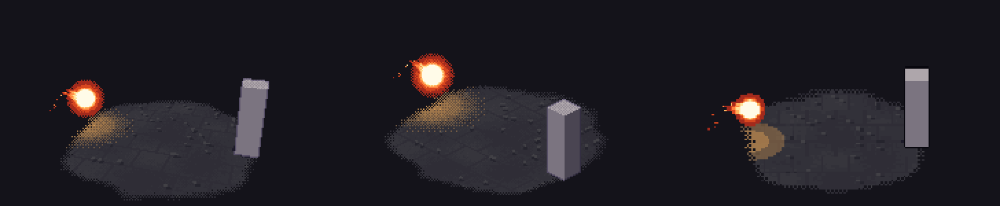
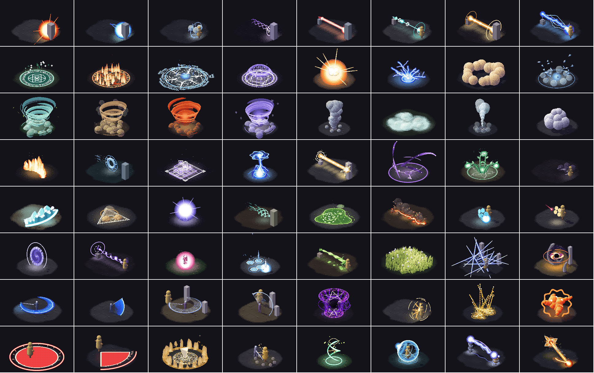

# Pixel VFX Codex

**92 pixel-art VFX: 64 game effects plus 28 original anime-style ultimate moves. One definition, three cameras: 3D, 2.5D and 2D. Tune any effect, then copy a prompt that rebuilds it in your own engine.**

**[▶ Live demo](https://888wing.github.io/pixel-vfx-codex/)** · [Promo video](https://github.com/888wing/pixel-vfx-codex/releases/tag/v1.0.0) · [Write your own effect](docs/AUTHORING.md) · [中文說明](#中文說明)



The effects are pixel-art reinterpretations of the [00GameDevs](https://00gamedevs.com/) VFX library (MIT). They are drawn with the rendering rules of [pixel-plays](https://github.com/amirmushichge/pixel-plays) (MIT): a low-resolution buffer with a depth buffer, hue-shifted colour ramps, a 4×4 Bayer dither and hard cast shadows, on a small diorama.

| Camera | Look |
|---|---|
| **3D** | Perspective camera that orbits (drag in the detail view). 240×150 with a light dither, 30 fps |
| **2.5D** | Fixed 30° isometric orthographic camera, the pixel-plays camera. 240×150 with full Bayer dither and long shadows, 20 fps |
| **2D** | Front-on oblique view. 160×100 with flat colour bands, no dither and 1 px outlines, stepped at 12 fps |

### Ultimates pack (28 original moves)

Anime-style ultimate moves with a caster, built from one reusable kit instead of one-off code. Each move runs in six
stages, **Pose → Charge → Shape → Motion → Impact → Aftermath**, and is composed from shared modules: energy core,
crescent slash, particle swarm, energy creature, growth, shockwave, aura, domain (the whole frame becomes another
world), debris, impact frame and aftermath. Swap one or two modules and you have a new move. The designs are
original: they study how famous ultimates create pressure and scale (compress then release, recolour the whole
screen, one huge clear shape, hit-stop contrast, marks left on the ground) without using any work's characters,
names or art. Their prompts list the stages and the modules to build. See `engine/kit.js` and the
[authoring guide](docs/AUTHORING.md#ultimates-pack-poses-stages-and-the-module-kit).



## What you can do

- **Browse** the 92 effects by pack (library / ultimates), type (projectile, beam, slash, domain, summon, aura…) or element, live in all three cameras, on a light or dark page.
- **Tune** every effect. Each one has 3–4 knobs of its own, such as missile count, fork count, flame height, arc angle or sector angle. Shared knobs cover main colour, size, brightness, particle density, hit-stop, screen shake, flash, pacing contrast, dither, outline and pixel density. Settings are remembered per effect.
- **Feel the hits.** A timing layer speeds up into each impact, freezes on it (hit-stop), shakes the camera, flashes and then slows out. A toggle switches it off so you can compare.
- **Copy a prompt** for Canvas 2D (plain JS), Three.js, Godot 4 or Unity URP, or an image-model prompt for a sprite sheet, in English or Traditional Chinese. Each prompt includes the camera spec, the palette in hex, the timeline, a layer-by-layer breakdown, the pacing and impact numbers, every knob with its current value, how to build it in that engine, and acceptance checks.
- **Export a sprite sheet** (PNG) of any effect in any camera, optionally without background and props.

## Run it

It is a static site with no build step and no runtime dependencies. Open `index.html` directly (it works from `file://`) or serve the folder with any static server. GitHub Pages serves it as-is.

## How it works

- `engine/pxfx.js` is a small software rasteriser. Its primitives cover solids (balls, crystals, rocks, boxes) and light (glows, beams, rings, lightning, ground decals, camera-facing cards, sphere shells, ribbons). Light is collected in a per-pixel buffer and resolved through colour ramps with ordered dithering. There are also screen operations: warp, flash and post.
- Every effect is `fx/<id>.js`: `PXFX.define({ id, loop, view, stage, palette, timeline, layers, beats, params, draw(p, t) })`. `draw` is a pure function of time, so any frame can be scrubbed to and exported.
- `PXFX.timing(def, tune)` turns an effect's `beats` (hit / burst / cast / pulse) into a display-time map with hit-stop, eased pacing, whole-pixel screen shake and a light flash.
- `engine/kit.js` holds the Ultimates modules (caster poses, charge, core, crescent, swarm formations, serpent, growth, shockwave, aura, domain, aftermath).
- `engine/prompt.js` writes the prompts from each definition. `app.js` runs the catalogue on one shared renderer with a per-frame time budget.

See [docs/AUTHORING.md](docs/AUTHORING.md) for the full API and the style and motion rules.

## Tools (optional, Node 18+)

```bash
node tools/snap.mjs fireball --night        # render an effect headless to a PNG contact sheet
node tools/gallery.mjs                       # QA every effect: errors, timing, loop pops, knob extremes
node tools/media.mjs fireball                # README hero GIF (needs ffmpeg)
npm install && node tools/site-check.mjs     # browser checks (puppeteer; set CHROME to use a local Chrome)
```

`promo/` holds the script for the vertical promo video. Its frames are rendered by the same engine; the audio files are not included.

## Credits and license

- Ultimates pack: original designs, MIT, part of this repository.
- Effect designs of the 64-effect library: [00GameDevs](https://00gamedevs.com/) VFX library, MIT, © 00GameDevs (@00vchannel). Names, descriptions, colours and timings in `data/` come from its catalogue. The 00GameDevs website UI and branding are not used.
- Rendering rules and techniques: [pixel-plays](https://github.com/amirmushichge/pixel-plays) by Amir Mushich, MIT. Its music is not used.
- Promo music and sound effects were generated with PixelBananas and are not part of this repository.
- Everything here is MIT; see [LICENSE](LICENSE) for all notices.

---

## 中文說明

64 個 [00GameDevs](https://00gamedevs.com/zh-TW/) 遊戲特效的像素風重製版，用 [pixel-plays](https://github.com/amirmushichge/pixel-plays) 的渲染規則畫成：低解析度、深度緩衝、色相偏移色階、4×4 Bayer 抖色、硬陰影，場景是一個浮在紙上的小島。每個特效只寫一份 3D 世界座標定義，由三部相機輸出：3D 透視（可轉）、2.5D 等角（pixel-plays 鏡頭）、2D 斜視（色塊分層、無抖色、1px 描邊）。

**[▶ 線上試玩](https://888wing.github.io/pixel-vfx-codex/)**

**必殺技包（28 個原創招式）**：動畫風大招，附施法者人偶。每招分為起手、集氣、成形、推進、命中、餘波六段，由共用模組組合而成：能量核心、彎月斬擊、粒子群陣形、能量生物、生長、衝擊波、氣場、領域（整個畫面換成另一個世界）、碎片、衝擊格與餘波痕跡。換掉一兩個模組就是一個新招式。設計全部原創：拆解著名大招為何有壓迫感與規模感（先壓縮再爆發、整個畫面變色、一個巨大清晰的形狀、頓幀與速度反差、地面留下痕跡），但不使用任何作品的角色、名稱或美術。這些招式的 prompt 會列出六段時間軸和要做的模組。

- **瀏覽**：按特效包（特效庫／必殺技）、類型或元素篩選，三種鏡頭即時預覽，有日間和夜間底色。
- **調整**：每個特效有 3–4 個專屬參數。通用參數包括主色、尺寸、亮度、粒子密度、頓幀、震屏、閃光、節奏對比、抖色、描邊和像素密度。設定按特效分別記住。
- **打擊感**：節奏層會在命中前加速、命中時頓幀、鏡頭震動、瞬間閃光，命中後先快後慢；可以一鍵關閉作 A/B 對比。
- **一鍵複製 prompt**：目標可選 Canvas 2D、Three.js、Godot 4、Unity URP，或 AI 繪圖 sprite sheet，中英皆可。內容包括鏡頭規格、調色盤 hex、時間軸、圖層拆解、節奏與打擊感數值、全部參數現值、實作方法和驗收要求。
- **匯出 sprite sheet**（PNG），可去背景及道具。

直接打開 `index.html` 即可使用，無建置步驟、無依賴。寫新特效請看 [docs/AUTHORING.md](docs/AUTHORING.md)。

授權：MIT。00GameDevs 與 pixel-plays 的 MIT 聲明見 [LICENSE](LICENSE)。
